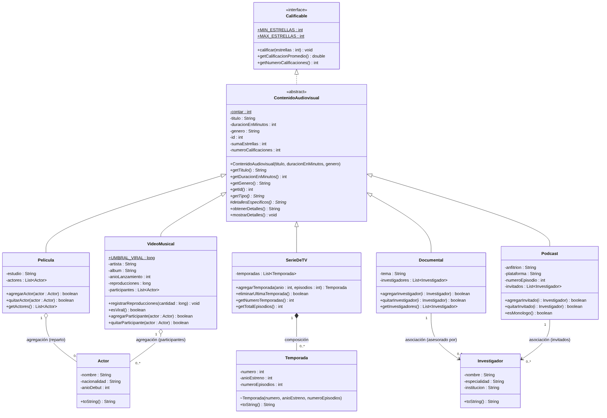

# Sistema de Contenido Audiovisual — POO Unidad 2

**Universidad Politécnica Salesiana · Ingeniería en Software · Programación Orientada a Objetos**
**Unidad 2: Relación entre Clases** · Autor: **Andy Javier Ortiz Valdiviezo** · Docente: Gustavo Navas Ruilova

---

## 1. Descripción del proyecto

Aplicación de consola en Java que administra un catálogo de contenido audiovisual (películas, series de TV, documentales, videos musicales y podcasts) junto con las personas relacionadas con ese contenido: actores, temporadas de las series e investigadores que asesoran.

El proyecto parte del **Código Ejemplo 30** del docente ([poo_unidad1](https://github.com/CS-Programacion-Orientada-Objetos/poo_unidad1)), que solo tenía la jerarquía `ContenidoAudiovisual → Pelicula / SerieDeTV / Documental`. Se amplió para aplicar en la práctica los temas de la unidad:

| Tema de la unidad | Dónde se aplica |
|---|---|
| Herencia y polimorfismo (Clase 6) | 5 subclases de `ContenidoAudiovisual`; `mostrarDetalles()` / `obtenerDetalles()` sobrescritos |
| Paquetes e interfaces (Clase 7) | Paquetes `modelo`, `vista`, `controlador`, `app`; interfaz `Calificable` |
| Asociación, agregación y composición (Clase 8) | `Documental → Investigador`, `Pelicula ◇ Actor`, `SerieDeTV ◆ Temporada` |
| Diagrama de clases (Clase 9) | `docs/diagrama-clases.png` (también se muestra abajo) |
| Patrón MVC (Clase 10) | `modelo` + `vista.VistaConsola` + `controlador.CatalogoController` |

**¿Qué problema resuelve?** Permite registrar, relacionar, calificar, buscar, editar y eliminar contenido audiovisual de forma ordenada, mostrando cómo se comportan los objetos según el tipo de relación (por ejemplo, al eliminar una serie desaparecen sus temporadas, pero al eliminar una película sus actores siguen registrados).

## 2. Objetivos

- Ampliar un proyecto Java existente aplicando herencia, asociación, agregación y composición.
- Documentar el diseño con un diagrama de clases UML.
- Construir un sistema funcional que permita crear y manipular objetos de todas las clases.
- Gestionar el proyecto con Git y GitHub mediante commits por etapa.

## 3. Clases y funcionalidades nuevas

| Clase | Tipo | Relación | Justificación |
|---|---|---|---|
| `Actor` | Nueva | **Agregación** con `Pelicula` (0..*) y `VideoMusical` (0..*) | El actor existe por sí solo y puede estar en varios contenidos; si se elimina la película, el actor sigue existiendo. |
| `Temporada` | Nueva | **Composición** con `SerieDeTV` (0..*) | Solo la serie crea sus temporadas (constructor de paquete, numeración automática); mueren con la serie. |
| `Investigador` | Nueva | **Asociación** con `Documental` y `Podcast` (0..*) | El contenido conoce a sus asesores/invitados, sin relación todo-parte. |
| `VideoMusical` | Nueva subclase | Hereda de `ContenidoAudiovisual`; agrega `Actor` | Artista, álbum, año, reproducciones y regla `esViral()` (≥ 1 000 000). |
| `Podcast` | Nueva subclase | Hereda de `ContenidoAudiovisual`; se asocia con `Investigador` | Anfitrión, plataforma, número de episodio e invitados; `esMonologo()`. |
| `Calificable` | Interfaz | La implementa `ContenidoAudiovisual` | Calificación de 1 a 5 estrellas con promedio para todo el contenido. |
| `CatalogoController` | Controlador MVC | Usa todas las clases del modelo | Lógica de negocio y validaciones (sin imprimir nada). |
| `VistaConsola` | Vista MVC | Usa el controlador | Menú de 15 opciones con lectura segura de datos. |
| `PruebasSistema` | Pruebas | — | 18 pruebas automáticas que verifican herencia, relaciones y validaciones. |

## 4. Diagrama de clases



> Fuente editable en [`docs/diagrama-clases.mmd`](docs/diagrama-clases.mmd) (Mermaid). La primera versión (antes de las nuevas subclases) está en `docs/diagrama-clases-v1.png`.

## 5. Estructura de carpetas

```
├── src/
│   ├── main/java/
│   │   ├── app/            → PruebaAudioVisual (método main)
│   │   ├── controlador/    → CatalogoController
│   │   ├── modelo/         → ContenidoAudiovisual, Pelicula, SerieDeTV, Documental,
│   │   │                     VideoMusical, Podcast, Actor, Temporada, Investigador, Calificable
│   │   └── vista/          → VistaConsola
│   └── test/java/
│       └── pruebas/        → PruebasSistema
├── docs/                   → diagramas de clases (PNG + fuente Mermaid)
├── .classpath / .project   → configuración del proyecto Eclipse
└── README.md
```

## 6. Instalación y ejecución

**Requisitos:** JDK 17 o superior (probado con JDK 25) y Eclipse IDE for Java Developers. Git para clonar.

### Opción A — Eclipse (recomendada)

1. Clonar el repositorio:
   ```bash
   git clone https://github.com/soyandyortiz/POO-U2-AndyOrtiz.git
   ```
2. En Eclipse: **File → Import → General → Existing Projects into Workspace** → *Select root directory* → elegir la carpeta clonada → **Finish**.
3. Ejecutar el sistema: clic derecho en `src/main/java/app/PruebaAudioVisual.java` → **Run As → Java Application**.
4. Ejecutar las pruebas: clic derecho en `src/test/java/pruebas/PruebasSistema.java` → **Run As → Java Application**.

### Opción B — Consola (CMD / terminal)

```bash
git clone https://github.com/soyandyortiz/POO-U2-AndyOrtiz.git
cd POO-U2-AndyOrtiz
javac -encoding UTF-8 -d bin src/main/java/modelo/*.java src/main/java/controlador/*.java src/main/java/vista/*.java src/main/java/app/*.java src/test/java/pruebas/*.java
java -cp bin app.PruebaAudioVisual
java -cp bin pruebas.PruebasSistema
```

## 7. Ejemplo de uso

Al iniciar se cargan datos de ejemplo (Avatar, Game of Thrones, Cosmos, un video musical y un podcast) y se muestra el menú:

```
=========== SISTEMA DE CONTENIDO AUDIOVISUAL ===========
 1. Listar catálogo            9. Calificar contenido
 2. Ver detalle por ID        10. Registrar reproducciones (video)
 3. Registrar contenido       11. Editar título/duración/género
 4. Registrar actor           12. Buscar por título
 5. Registrar investigador    13. Eliminar contenido
 6. Asignar actor             14. Ver actores e investigadores
 7. Asignar investigador      15. Resumen del catálogo
 8. Agregar temporada a serie  0. Salir
=========================================================
Seleccione una opción: 1
[0] Película      | Avatar (125 min) | 4.5/5
[1] Serie de TV   | Game of Thrones (60 min) | 5.0/5
[2] Documental    | Cosmos (45 min) | 0.0/5
[3] Video musical | Vivir mi vida (5 min) | 0.0/5
[4] Podcast       | El universo en 30 minutos (30 min) | 4.0/5
```

Ejemplo de detalle (opción 2, ID 1) donde se ve la composición serie–temporadas:

```
Detalles (Serie de TV):
ID: 1
Título: Game of Thrones
Duración en minutos: 60
Género: Fantasía
Calificación: 5.0/5 (1 votos)
Temporadas: 2 | Episodios totales: 20
  - Temporada 1 (2011) - 10 episodios
  - Temporada 2 (2012) - 10 episodios
```

## 8. Mejoras adicionales implementadas

- **Corrección de un error del código base:** `SerieDeTV` y `Documental` imprimían "Detalles de la película". Se resolvió con un *método plantilla* (`obtenerDetalles()` en la superclase + `detallesEspecificos()` en cada subclase), lo que además elimina el código repetido.
- **Encapsulamiento de las relaciones:** las listas se exponen con `Collections.unmodifiableList`, se evitan duplicados y `Temporada` no puede crearse fuera del paquete `modelo`.
- **Validaciones** con `IllegalArgumentException` (duración > 0, estrellas 1–5, IDs existentes, tipo de contenido correcto) y lectura segura de datos en la vista (no se cae si el usuario escribe letras).
- **Interfaz `Calificable`** y **resumen estadístico** del catálogo (conteo por tipo, duración total, mejor calificado).
- **18 pruebas automáticas** en `src/test/java` sin dependencias externas.

## 9. Historial de trabajo (commits)

| Commit | Etapa |
|---|---|
| Unidad 1 - v1.0 … v1.3 | Código base del docente |
| Etapa 1 | Reorganización a `src/main/java` y corrección de `mostrarDetalles` |
| Etapa 2 y 3 | `Actor`, `Temporada`, `Investigador` + relaciones + diagrama v1 |
| Etapa 4 | Subclases `VideoMusical` y `Podcast`, interfaz `Calificable`, diagrama actualizado |
| Etapa 5 | Patrón MVC, menú funcional y pruebas automáticas |
| Etapa 6 | Este README |

---
Universidad Politécnica Salesiana · 2026
